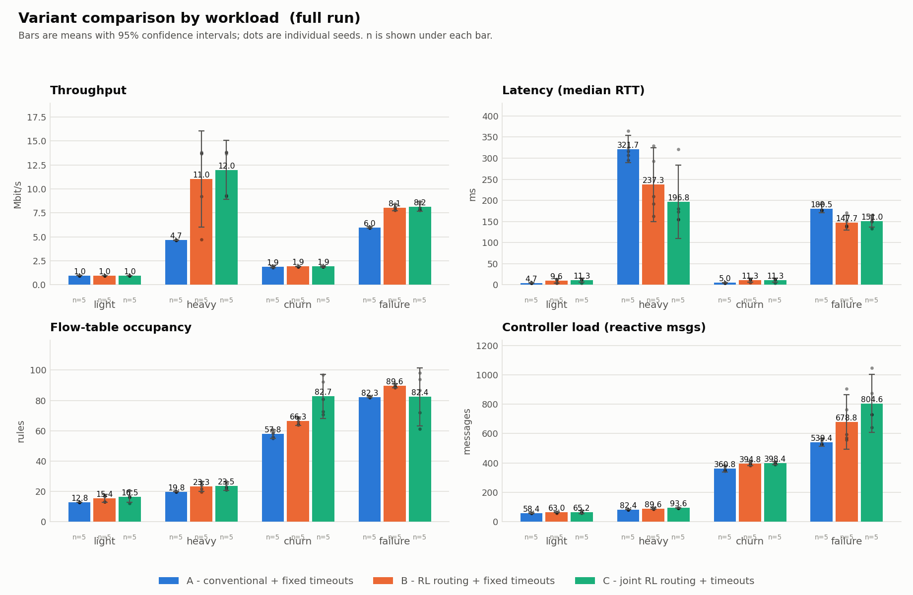
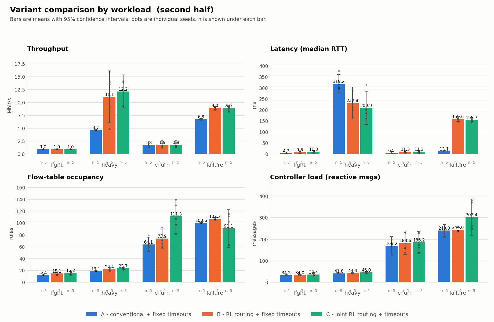
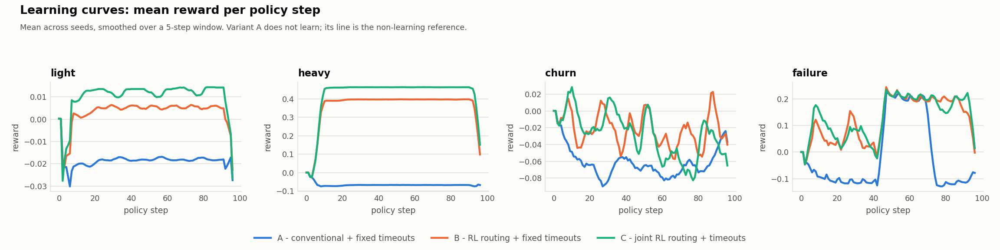
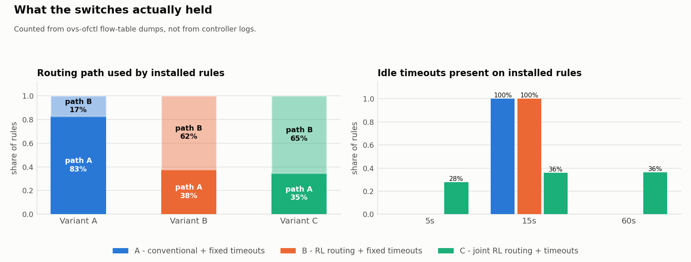
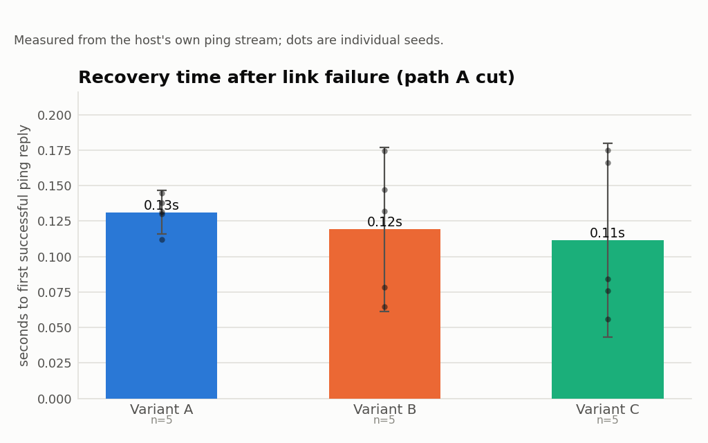

# RL-Based SDN Traffic Routing and Flow-Table Optimization

**Experimental report — generated from measured results only.**

This document is produced by `analysis/report.py` from the contents of `results/runs/`. Every figure in it was computed from raw measurement files by script. No value was entered by hand, and no value is taken from published literature.

## 1. What was measured

Three controller variants were compared under identical seeded traffic on an emulated five-switch network:

| Variant | Routing | Flow-rule timeouts |
|---|---|---|
| A | conventional shortest-path (fewest hops) | fixed |
| B | Q-learning selects the path | fixed |
| C | Q-learning selects the path | Q-learning selects the timeout |

A and B differ in one respect; B and C differ in one respect. Any difference between B and C is therefore attributable to flow-timeout control alone.

```
switches: 5 ('s1', 's2', 's3', 's4', 's5')
hosts:    4 h1=10.0.0.1@s1:1, h2=10.0.0.2@s1:2, h3=10.0.0.3@s4:1, h4=10.0.0.4@s4:2
core links:
  s1:3 <-> s2:1  bw=5.0Mbit delay=1.0ms
  s2:2 <-> s4:3  bw=5.0Mbit delay=1.0ms
  s1:4 <-> s3:1  bw=10.0Mbit delay=2.0ms
  s3:2 <-> s5:1  bw=10.0Mbit delay=2.0ms
  s5:2 <-> s4:4  bw=10.0Mbit delay=2.0ms
candidate paths (s1->s4):
  A: s1 -> s2 -> s4  bottleneck=5.0Mbit
  B: s1 -> s3 -> s5 -> s4  bottleneck=10.0Mbit
```

Path A is shorter but narrower, so the better path depends on load. A fixed policy cannot be optimal in both regimes; a state-conditioned one can. This is the property the experiment is built to test, and it is also the main limit on how far the result generalises (see `docs/LIMITATIONS.md`).

## 2. Provenance and sample sizes

| Component | Version |
|---|---|
| `os_release` | "Ubuntu 26.04.1 LTS" |
| `kernel` | 6.18.54.1-microsoft-standard-WSL2 |
| `python` | 3.14.4 |
| `ovs_version` | ovs-vsctl (Open vSwitch) 3.7.1 |
| `mininet_version` | 2.3.0 |
| `os_ken_version` | 4.1.1-1ubuntu2 |
| `iperf3_version` | iperf 3.20 (cJSON 1.7.15) |
| `git_commit` | fatal: detected dubious ownership in repository at '/home/tathwaykumar/sdn-rl-project' |

- Run directories found: **62**
- Runs analysed (manifest complete): **61**
- Runs excluded as incomplete: **1**

> 1 run(s) did not produce every expected artefact and are excluded. They are counted here rather than silently dropped, because averaging over whatever survived would bias results toward whichever variant failed least gracefully.

Runs per cell:

| Workload | Variant A | Variant B | Variant C |
|---|---|---|---|
| `light` | 5 | 5 | 5 |
| `heavy` | 5 | 5 | 6 |
| `churn` | 5 | 5 | 5 |
| `failure` | 5 | 5 | 5 |

## 3. Did the learned actions reach the switches?

This is checked against `ovs-ofctl` flow-table dumps, not controller logs: a controller can log a decision it never installed, but a flow table cannot misreport what it holds.

| Variant | Paths installed | Idle timeouts installed | Rules checked | Path agreement | Timeout agreement |
|---|---|---|---|---|---|
| A | A:83%, B:17% | 15s | 5124 | 97.4% | 100.0% |
| B | A:38%, B:62% | 15s | 5053 | 99.2% | 100.0% |
| C | A:35%, B:65% | 5s, 15s, 60s | 5293 | 97.7% | 100.0% |

Each rule is matched against the decision that was in force **when that rule was installed** (recovered from the switch's own `duration` field), not against the controller's latest decision.

Claim checks:

- **PASS** — C varies flow-rule idle timeouts  
  distinct idle_timeout values installed: {'5': 5364, '15': 6942, '60': 7030}
- **PASS** — A keeps flow-rule timeouts fixed  
  distinct idle_timeout values installed: {'15': 16270}
- **PASS** — B keeps flow-rule timeouts fixed  
  distinct idle_timeout values installed: {'15': 18311}
- **PASS** — B uses both routing paths  
  path usage in installed rules: {'B': 3147, 'A': 1906}
- **PASS** — C uses both routing paths  
  path usage in installed rules: {'B': 3451, 'A': 1842}
- **PASS** — A: installed rules match the decision in force  
  97.4% of 5124 rules agree
- **PASS** — B: installed rules match the decision in force  
  99.2% of 5053 rules agree
- **PASS** — C: installed rules match the decision in force  
  97.7% of 5293 rules agree
- **PASS** — B's path distribution differs from A's  
  A={'A': 0.8257, 'B': 0.1743} vs B={'B': 0.6228, 'A': 0.3772}
- **PASS** — C differs from B in installed timeouts  
  B={'15': 18311} vs C={'5': 5364, '15': 6942, '60': 7030}

## 4. Results — full run

Cells are the **median across seeds** with the interquartile range in brackets, and `n` is the number of runs contributing.

### Workload `light`

| Metric | A | B | C |
|---|---|---|---|
| Throughput (OF counters) (Mbit/s) | 0.98 [IQR 0.01] (n=5) | 0.97 [IQR 0.00] (n=5) | 0.97 [IQR 0.01] (n=5) |
| Throughput (iperf3) (Mbit/s) | 1.00 [IQR 0.00] (n=5) | 1.00 [IQR 0.00] (n=5) | 1.00 [IQR 0.00] (n=5) |
| Latency, median RTT | 4.59 [IQR 0.22] (n=5) | 12.60 [IQR 7.88] (n=5) | 12.70 [IQR 0.60] (n=5) |
| Latency, p95 RTT | 96.03 [IQR 1.62] (n=5) | 36.70 [IQR 62.79] (n=5) | 35.62 [IQR 2.10] (n=5) |
| Packet loss (ping) (%) | 0.00 [IQR 0.00] (n=5) | 0.00 [IQR 0.00] (n=5) | 0.00 [IQR 0.00] (n=5) |
| Packet loss (OF counters) (%) | 0.000 [IQR 0.000] (n=5) | 0.000 [IQR 0.000] (n=5) | 0.000 [IQR 0.000] (n=5) |
| Max link utilisation (%) | 19.1 [IQR 0.2] (n=5) | 9.6 [IQR 9.4] (n=5) | 9.5 [IQR 0.1] (n=5) |
| Flow-table occupancy (rules) | 12.8 [IQR 0.0] (n=5) | 16.9 [IQR 4.1] (n=5) | 16.4 [IQR 0.9] (n=5) |
| Rule-hit ratio (%) | 99.88 [IQR 0.02] (n=5) | 99.91 [IQR 0.02] (n=5) | 99.91 [IQR 0.00] (n=5) |
| Table misses (total) | 8 [IQR 0] (n=5) | 8 [IQR 1] (n=5) | 8 [IQR 1] (n=5) |
| Controller messages (reactive) | 58 [IQR 1] (n=5) | 63 [IQR 3] (n=5) | 63 [IQR 3] (n=5) |

### Workload `heavy`

| Metric | A | B | C |
|---|---|---|---|
| Throughput (OF counters) (Mbit/s) | 4.67 [IQR 0.01] (n=5) | 13.68 [IQR 4.47] (n=5) | 13.69 [IQR 3.40] (n=6) |
| Throughput (iperf3) (Mbit/s) | 4.81 [IQR 0.02] (n=5) | 14.18 [IQR 4.63] (n=5) | 14.20 [IQR 3.48] (n=6) |
| Latency, median RTT | 317.00 [IQR 18.00] (n=5) | 210.00 [IQR 100.50] (n=5) | 172.00 [IQR 18.50] (n=6) |
| Latency, p95 RTT | 437.45 [IQR 2.70] (n=5) | 240.00 [IQR 196.30] (n=5) | 231.50 [IQR 1.00] (n=6) |
| Packet loss (ping) (%) | 96.29 [IQR 0.22] (n=5) | 64.71 [IQR 60.57] (n=5) | 26.14 [IQR 6.92] (n=6) |
| Packet loss (OF counters) (%) | 0.000 [IQR 0.000] (n=5) | 0.000 [IQR 0.000] (n=5) | 0.000 [IQR 0.000] (n=6) |
| Max link utilisation (%) | 91.3 [IQR 0.2] (n=5) | 90.9 [IQR 0.6] (n=5) | 90.9 [IQR 0.4] (n=6) |
| Flow-table occupancy (rules) | 19.8 [IQR 0.2] (n=5) | 24.0 [IQR 3.3] (n=5) | 22.9 [IQR 2.0] (n=6) |
| Rule-hit ratio (%) | 99.89 [IQR 0.26] (n=5) | 99.92 [IQR 0.28] (n=5) | 99.92 [IQR 0.16] (n=6) |
| Table misses (total) | 15 [IQR 1] (n=5) | 15 [IQR 1] (n=5) | 16 [IQR 1] (n=6) |
| Controller messages (reactive) | 82 [IQR 1] (n=5) | 88 [IQR 5] (n=5) | 94 [IQR 3] (n=6) |

### Workload `churn`

| Metric | A | B | C |
|---|---|---|---|
| Throughput (OF counters) (Mbit/s) | 1.89 [IQR 0.02] (n=5) | 1.90 [IQR 0.02] (n=5) | 1.89 [IQR 0.01] (n=5) |
| Throughput (iperf3) (Mbit/s) | 1.92 [IQR 0.05] (n=5) | 1.96 [IQR 0.02] (n=5) | 1.96 [IQR 0.00] (n=5) |
| Latency, median RTT | 4.92 [IQR 0.60] (n=5) | 12.70 [IQR 0.30] (n=5) | 13.00 [IQR 0.40] (n=5) |
| Latency, p95 RTT | 257.05 [IQR 85.60] (n=5) | 43.59 [IQR 7.82] (n=5) | 40.79 [IQR 7.96] (n=5) |
| Packet loss (ping) (%) | 7.21 [IQR 3.91] (n=5) | 0.00 [IQR 0.00] (n=5) | 0.00 [IQR 0.00] (n=5) |
| Packet loss (OF counters) (%) | 0.000 [IQR 0.000] (n=5) | 0.000 [IQR 0.000] (n=5) | 0.000 [IQR 0.000] (n=5) |
| Max link utilisation (%) | 36.9 [IQR 0.3] (n=5) | 26.3 [IQR 1.0] (n=5) | 25.9 [IQR 0.7] (n=5) |
| Flow-table occupancy (rules) | 58.3 [IQR 3.0] (n=5) | 66.2 [IQR 3.5] (n=5) | 80.8 [IQR 19.6] (n=5) |
| Rule-hit ratio (%) | 99.50 [IQR 0.07] (n=5) | 99.60 [IQR 0.05] (n=5) | 99.59 [IQR 0.10] (n=5) |
| Table misses (total) | 50 [IQR 0] (n=5) | 50 [IQR 0] (n=5) | 50 [IQR 1] (n=5) |
| Controller messages (reactive) | 351 [IQR 21] (n=5) | 397 [IQR 11] (n=5) | 397 [IQR 8] (n=5) |

### Workload `failure`

| Metric | A | B | C |
|---|---|---|---|
| Throughput (OF counters) (Mbit/s) | 5.97 [IQR 0.02] (n=5) | 8.10 [IQR 0.26] (n=5) | 8.04 [IQR 0.65] (n=5) |
| Throughput (iperf3) (Mbit/s) | 5.74 [IQR 0.12] (n=5) | 7.88 [IQR 0.36] (n=5) | 7.89 [IQR 0.69] (n=5) |
| Latency, median RTT | 177.00 [IQR 1.00] (n=5) | 140.00 [IQR 11.50] (n=5) | 152.00 [IQR 7.00] (n=5) |
| Latency, p95 RTT | 424.00 [IQR 0.25] (n=5) | 233.30 [IQR 160.60] (n=5) | 225.30 [IQR 4.00] (n=5) |
| Packet loss (ping) (%) | 45.63 [IQR 1.53] (n=5) | 19.61 [IQR 14.81] (n=5) | 15.03 [IQR 3.05] (n=5) |
| Packet loss (OF counters) (%) | 0.000 [IQR 0.000] (n=5) | 0.000 [IQR 0.000] (n=5) | 0.000 [IQR 0.000] (n=5) |
| Max link utilisation (%) | 90.3 [IQR 0.6] (n=5) | 88.6 [IQR 0.1] (n=5) | 87.8 [IQR 0.9] (n=5) |
| Flow-table occupancy (rules) | 82.3 [IQR 0.5] (n=5) | 89.4 [IQR 0.9] (n=5) | 86.7 [IQR 21.8] (n=5) |
| Rule-hit ratio (%) | 99.87 [IQR 0.01] (n=5) | 99.90 [IQR 0.02] (n=5) | 99.89 [IQR 0.03] (n=5) |
| Table misses (total) | 62 [IQR 0] (n=5) | 65 [IQR 22] (n=5) | 68 [IQR 41] (n=5) |
| Controller messages (reactive) | 529 [IQR 23] (n=5) | 596 [IQR 190] (n=5) | 731 [IQR 146] (n=5) |
| Recovery time | 0.13 [IQR 0.01] (n=5) | 0.13 [IQR 0.07] (n=5) | 0.08 [IQR 0.09] (n=5) |

## 5. Results — second half of each run

Exploration decays over the first half of each run, so this window is closer to the policy the agents converged on. Both windows are reported; neither is hidden.

Cells are the **median across seeds** with the interquartile range in brackets, and `n` is the number of runs contributing.

### Workload `light`

| Metric | A | B | C |
|---|---|---|---|
| Throughput (OF counters) (Mbit/s) | 0.97 [IQR 0.00] (n=5) | 0.95 [IQR 0.02] (n=5) | 0.95 [IQR 0.02] (n=5) |
| Throughput (iperf3) (Mbit/s) | 1.00 [IQR 0.00] (n=5) | 1.00 [IQR 0.00] (n=5) | 1.00 [IQR 0.00] (n=5) |
| Latency, median RTT | 4.57 [IQR 0.18] (n=5) | 12.60 [IQR 7.91] (n=5) | 12.70 [IQR 0.50] (n=5) |
| Latency, p95 RTT | 94.28 [IQR 5.32] (n=5) | 36.70 [IQR 64.61] (n=5) | 31.34 [IQR 2.36] (n=5) |
| Packet loss (ping) (%) | 0.00 [IQR 0.00] (n=5) | 0.00 [IQR 0.00] (n=5) | 0.00 [IQR 0.00] (n=5) |
| Packet loss (OF counters) (%) | 0.000 [IQR 0.000] (n=5) | 0.000 [IQR 0.000] (n=5) | 0.000 [IQR 0.000] (n=5) |
| Max link utilisation (%) | 18.8 [IQR 0.1] (n=5) | 9.5 [IQR 9.0] (n=5) | 9.3 [IQR 0.2] (n=5) |
| Flow-table occupancy (rules) | 12.5 [IQR 0.1] (n=5) | 16.6 [IQR 3.8] (n=5) | 16.5 [IQR 0.7] (n=5) |
| Rule-hit ratio (%) | 99.99 [IQR 0.01] (n=5) | 99.99 [IQR 0.00] (n=5) | 99.99 [IQR 0.01] (n=5) |
| Table misses (total) | 2 [IQR 1] (n=5) | 2 [IQR 0] (n=5) | 2 [IQR 1] (n=5) |
| Controller messages (reactive) | 33 [IQR 1] (n=5) | 34 [IQR 2] (n=5) | 34 [IQR 2] (n=5) |

### Workload `heavy`

| Metric | A | B | C |
|---|---|---|---|
| Throughput (OF counters) (Mbit/s) | 4.74 [IQR 0.05] (n=5) | 13.61 [IQR 4.65] (n=5) | 13.76 [IQR 3.55] (n=6) |
| Throughput (iperf3) (Mbit/s) | 4.81 [IQR 0.02] (n=5) | 14.18 [IQR 4.63] (n=5) | 14.20 [IQR 3.48] (n=6) |
| Latency, median RTT | 304.00 [IQR 16.50] (n=5) | 212.00 [IQR 94.00] (n=5) | 191.75 [IQR 15.88] (n=6) |
| Latency, p95 RTT | 436.00 [IQR 13.95] (n=5) | 243.00 [IQR 183.80] (n=5) | 233.35 [IQR 2.28] (n=6) |
| Packet loss (ping) (%) | 96.29 [IQR 0.22] (n=5) | 64.71 [IQR 60.57] (n=5) | 26.14 [IQR 6.92] (n=6) |
| Packet loss (OF counters) (%) | 0.000 [IQR 0.000] (n=5) | 0.000 [IQR 0.000] (n=5) | 0.000 [IQR 0.000] (n=6) |
| Max link utilisation (%) | 92.8 [IQR 1.0] (n=5) | 91.7 [IQR 2.1] (n=5) | 91.6 [IQR 1.7] (n=6) |
| Flow-table occupancy (rules) | 19.0 [IQR 0.2] (n=5) | 23.1 [IQR 2.8] (n=5) | 23.4 [IQR 2.0] (n=6) |
| Rule-hit ratio (%) | 99.99 [IQR 0.00] (n=5) | 100.00 [IQR 0.00] (n=5) | 100.00 [IQR 0.00] (n=6) |
| Table misses (total) | 5 [IQR 1] (n=5) | 4 [IQR 0] (n=5) | 5 [IQR 1] (n=6) |
| Controller messages (reactive) | 42 [IQR 1] (n=5) | 43 [IQR 3] (n=5) | 47 [IQR 5] (n=6) |

### Workload `churn`

| Metric | A | B | C |
|---|---|---|---|
| Throughput (OF counters) (Mbit/s) | 1.62 [IQR 0.65] (n=5) | 1.63 [IQR 0.63] (n=5) | 1.62 [IQR 0.65] (n=5) |
| Throughput (iperf3) (Mbit/s) | 1.92 [IQR 0.05] (n=5) | 1.96 [IQR 0.02] (n=5) | 1.96 [IQR 0.00] (n=5) |
| Latency, median RTT | 4.97 [IQR 0.54] (n=5) | 12.70 [IQR 0.20] (n=5) | 12.90 [IQR 0.40] (n=5) |
| Latency, p95 RTT | 149.20 [IQR 222.80] (n=5) | 44.50 [IQR 15.60] (n=5) | 41.38 [IQR 7.88] (n=5) |
| Packet loss (ping) (%) | 7.21 [IQR 3.91] (n=5) | 0.00 [IQR 0.00] (n=5) | 0.00 [IQR 0.00] (n=5) |
| Packet loss (OF counters) (%) | 0.000 [IQR 0.000] (n=5) | 0.000 [IQR 0.000] (n=5) | 0.000 [IQR 0.000] (n=5) |
| Max link utilisation (%) | 31.6 [IQR 12.6] (n=5) | 25.6 [IQR 8.4] (n=5) | 23.7 [IQR 7.2] (n=5) |
| Flow-table occupancy (rules) | 60.5 [IQR 7.8] (n=5) | 70.7 [IQR 15.3] (n=5) | 107.3 [IQR 32.8] (n=5) |
| Rule-hit ratio (%) | 99.87 [IQR 0.03] (n=5) | 99.88 [IQR 0.03] (n=5) | 99.87 [IQR 0.01] (n=5) |
| Table misses (total) | 20 [IQR 7] (n=5) | 18 [IQR 7] (n=5) | 20 [IQR 7] (n=5) |
| Controller messages (reactive) | 172 [IQR 63] (n=5) | 161 [IQR 73] (n=5) | 173 [IQR 66] (n=5) |

### Workload `failure`

| Metric | A | B | C |
|---|---|---|---|
| Throughput (OF counters) (Mbit/s) | 6.83 [IQR 0.14] (n=5) | 9.05 [IQR 0.07] (n=5) | 9.09 [IQR 0.28] (n=5) |
| Throughput (iperf3) (Mbit/s) | 5.74 [IQR 0.12] (n=5) | 7.88 [IQR 0.36] (n=5) | 7.89 [IQR 0.69] (n=5) |
| Latency, median RTT | 13.00 [IQR 0.50] (n=5) | 162.00 [IQR 7.00] (n=5) | 155.50 [IQR 12.00] (n=5) |
| Latency, p95 RTT | 217.00 [IQR 13.10] (n=5) | 224.85 [IQR 2.70] (n=5) | 227.00 [IQR 1.00] (n=5) |
| Packet loss (ping) (%) | 45.63 [IQR 1.53] (n=5) | 19.61 [IQR 14.81] (n=5) | 15.03 [IQR 3.05] (n=5) |
| Packet loss (OF counters) (%) | 0.000 [IQR 0.000] (n=5) | 0.000 [IQR 0.000] (n=5) | 0.000 [IQR 0.000] (n=5) |
| Max link utilisation (%) | 90.6 [IQR 1.6] (n=5) | 89.0 [IQR 0.6] (n=5) | 88.9 [IQR 2.8] (n=5) |
| Flow-table occupancy (rules) | 100.4 [IQR 0.1] (n=5) | 107.0 [IQR 0.9] (n=5) | 102.3 [IQR 47.2] (n=5) |
| Rule-hit ratio (%) | 99.97 [IQR 0.00] (n=5) | 99.98 [IQR 0.00] (n=5) | 99.98 [IQR 0.00] (n=5) |
| Table misses (total) | 28 [IQR 0] (n=5) | 28 [IQR 0] (n=5) | 30 [IQR 2] (n=5) |
| Controller messages (reactive) | 245 [IQR 25] (n=5) | 241 [IQR 0] (n=5) | 262 [IQR 122] (n=5) |
| Recovery time | 0.13 [IQR 0.01] (n=5) | 0.13 [IQR 0.07] (n=5) | 0.08 [IQR 0.09] (n=5) |

## 6. Findings

Each comparison below is against variant A on the same workload, using the second-half window. A difference is only called a difference when the 95% confidence intervals do not overlap.

### `light`

**Variant B vs A**

- Throughput (OF counters): 2.0% lower (worse direction), but the 95% intervals overlap -- not distinguishable at n=5
- Latency, median RTT: 175.7% higher (worse direction), but the 95% intervals overlap -- not distinguishable at n=5
- Flow-table occupancy (rules): 32.9% higher (worse direction), but the 95% intervals overlap -- not distinguishable at n=5
- Controller messages (reactive): 3.0% higher (worse direction), but the 95% intervals overlap -- not distinguishable at n=5

**Variant C vs A**

- Throughput (OF counters): 1.2% lower (worse direction), but the 95% intervals overlap -- not distinguishable at n=5
- Latency, median RTT: 177.9% higher -- worse; 95% intervals do not overlap
- Flow-table occupancy (rules): 31.9% higher -- worse; 95% intervals do not overlap
- Controller messages (reactive): 3.0% higher (worse direction), but the 95% intervals overlap -- not distinguishable at n=5

**Variant C vs B** (isolates flow-timeout control)

- Throughput (OF counters): 0.8% higher (better direction), but the 95% intervals overlap -- not distinguishable at n=5
- Latency, median RTT: 0.8% higher (worse direction), but the 95% intervals overlap -- not distinguishable at n=5
- Flow-table occupancy (rules): 0.7% lower (better direction), but the 95% intervals overlap -- not distinguishable at n=5
- Controller messages (reactive): 0.0% higher (worse direction), but the 95% intervals overlap -- not distinguishable at n=5

### `heavy`

> **Read latency together with loss here.** Probe loss differs substantially between variants (A 96%, B 65%, C 26%), so the RTT medians below are computed over different populations of surviving probes. A variant that drops more traffic can show a lower median RTT without being better: the packets that would have been slow were never delivered.

**Variant B vs A**

- Throughput (OF counters): 187.3% higher -- better; 95% intervals do not overlap
- Latency, median RTT: 30.3% lower (better direction), but the 95% intervals overlap -- not distinguishable at n=5
- Flow-table occupancy (rules): 21.7% higher -- worse; 95% intervals do not overlap
- Controller messages (reactive): 2.4% higher (worse direction), but the 95% intervals overlap -- not distinguishable at n=5

**Variant C vs A**

- Throughput (OF counters): 190.4% higher -- better; 95% intervals do not overlap
- Latency, median RTT: 36.9% lower -- better; 95% intervals do not overlap
- Flow-table occupancy (rules): 23.4% higher -- worse; 95% intervals do not overlap
- Controller messages (reactive): 10.7% higher -- worse; 95% intervals do not overlap

**Variant C vs B** (isolates flow-timeout control)

- Throughput (OF counters): 1.1% higher (better direction), but the 95% intervals overlap -- not distinguishable at n=5
- Latency, median RTT: 9.6% lower (better direction), but the 95% intervals overlap -- not distinguishable at n=5
- Flow-table occupancy (rules): 1.4% higher (worse direction), but the 95% intervals overlap -- not distinguishable at n=5
- Controller messages (reactive): 8.1% higher (worse direction), but the 95% intervals overlap -- not distinguishable at n=5

### `churn`

**Variant B vs A**

- Throughput (OF counters): 0.6% higher (better direction), but the 95% intervals overlap -- not distinguishable at n=5
- Latency, median RTT: 155.5% higher (worse direction), but the 95% intervals overlap -- not distinguishable at n=5
- Flow-table occupancy (rules): 16.9% higher (worse direction), but the 95% intervals overlap -- not distinguishable at n=5
- Controller messages (reactive): 6.4% lower (better direction), but the 95% intervals overlap -- not distinguishable at n=5

**Variant C vs A**

- Throughput (OF counters): 0.0% higher (better direction), but the 95% intervals overlap -- not distinguishable at n=5
- Latency, median RTT: 159.6% higher (worse direction), but the 95% intervals overlap -- not distinguishable at n=5
- Flow-table occupancy (rules): 77.5% higher -- worse; 95% intervals do not overlap
- Controller messages (reactive): 0.6% higher (worse direction), but the 95% intervals overlap -- not distinguishable at n=5

**Variant C vs B** (isolates flow-timeout control)

- Throughput (OF counters): 0.6% lower (worse direction), but the 95% intervals overlap -- not distinguishable at n=5
- Latency, median RTT: 1.6% higher (worse direction), but the 95% intervals overlap -- not distinguishable at n=5
- Flow-table occupancy (rules): 51.8% higher (worse direction), but the 95% intervals overlap -- not distinguishable at n=5
- Controller messages (reactive): 7.5% higher (worse direction), but the 95% intervals overlap -- not distinguishable at n=5

### `failure`

> **Read latency together with loss here.** Probe loss differs substantially between variants (A 46%, B 20%, C 15%), so the RTT medians below are computed over different populations of surviving probes. A variant that drops more traffic can show a lower median RTT without being better: the packets that would have been slow were never delivered.

**Variant B vs A**

- Throughput (OF counters): 32.5% higher -- better; 95% intervals do not overlap
- Latency, median RTT: 1146.2% higher -- worse; 95% intervals do not overlap
- Flow-table occupancy (rules): 6.6% higher -- worse; 95% intervals do not overlap
- Controller messages (reactive): 1.6% lower (better direction), but the 95% intervals overlap -- not distinguishable at n=5
- Recovery time: 0.1% higher (worse direction), but the 95% intervals overlap -- not distinguishable at n=5

**Variant C vs A**

- Throughput (OF counters): 33.2% higher -- better; 95% intervals do not overlap
- Latency, median RTT: 1096.2% higher -- worse; 95% intervals do not overlap
- Flow-table occupancy (rules): 2.0% higher (worse direction), but the 95% intervals overlap -- not distinguishable at n=5
- Controller messages (reactive): 6.9% higher (worse direction), but the 95% intervals overlap -- not distinguishable at n=5
- Recovery time: 36.2% lower (better direction), but the 95% intervals overlap -- not distinguishable at n=5

**Variant C vs B** (isolates flow-timeout control)

- Throughput (OF counters): 0.5% higher (better direction), but the 95% intervals overlap -- not distinguishable at n=5
- Latency, median RTT: 4.0% lower (better direction), but the 95% intervals overlap -- not distinguishable at n=5
- Flow-table occupancy (rules): 4.3% lower (better direction), but the 95% intervals overlap -- not distinguishable at n=5
- Controller messages (reactive): 8.7% higher (worse direction), but the 95% intervals overlap -- not distinguishable at n=5
- Recovery time: 36.3% lower (better direction), but the 95% intervals overlap -- not distinguishable at n=5

## 7. Learning behaviour

| Variant | Policy steps | Mean reward | Reward 2nd half − 1st half | Exploration | States visited (of 144) | Distinct greedy actions |
|---|---|---|---|---|---|---|
| A | 98 | -0.040 | +0.000 | n/a | n/a | n/a |
| B | 98 | 0.016 | +0.001 | 11.8% | 5 | 2 |
| C | 98 | 0.104 | -0.000 | 19.4% | 5 | 4 |

Variant A has no agent; the controller computes the same reward for it, so its row is the non-learning reference rather than evidence of learning. A reward delta near zero for A is therefore expected and is a useful check that the reward itself is not simply drifting upward over a run for reasons unrelated to the policy.

## 8. Figures



*Variant comparison by workload, full run.*



*Variant comparison, second-half window.*



*Mean reward per policy step.*



*Paths and idle timeouts actually installed on the switches.*



*Recovery time after a link failure on path A.*

## 9. How to read these numbers

- **Five seeds per cell.** The confidence intervals are wide and are computed with a t critical value. Overlapping intervals mean *not distinguishable at this sample size*, not *no difference*. No significance test is claimed.
- **The agents are still learning during measurement.** Each run is ~90 decision steps from a cold start. This is not a train-then-test protocol; the second-half window is the closest available approximation.
- **Absolute latency figures carry WSL2 scheduling noise** and are not comparable with hardware testbed results. The relative comparison between variants is run on one host with identical seeded traffic and is the meaningful part.
- **Latency and loss must be read together.** RTT is measured only over probes that returned. Where loss rates differ sharply between variants, the medians summarise different populations and a lower median can reflect more aggressive dropping rather than better service. The per-workload sections flag this where it applies.
- **Check state coverage before reading the learning results.** The table in section 7 reports how many of the 144 states each agent actually visited. Where that number is small and the reward delta is near zero, the measured differences between variants cannot be attributed to a converged learned policy; they reflect the behaviour the policy produced during the run, exploration included. The null-control and action-shuffle diagnostics are the test that separates those.
- **Variant C has a larger action space than B** on the same step budget, so less experience per action. If C does not beat B, that is partly an exploration-budget artefact and not purely evidence against joint control.
- Full detail in `docs/LIMITATIONS.md` and `docs/ASSUMPTIONS.md`.

---

*Generated by `analysis/report.py`. Regenerate with:* `python3 -m analysis.aggregate && python3 -m analysis.verify_behaviour && python3 -m analysis.plots && python3 -m analysis.report`
